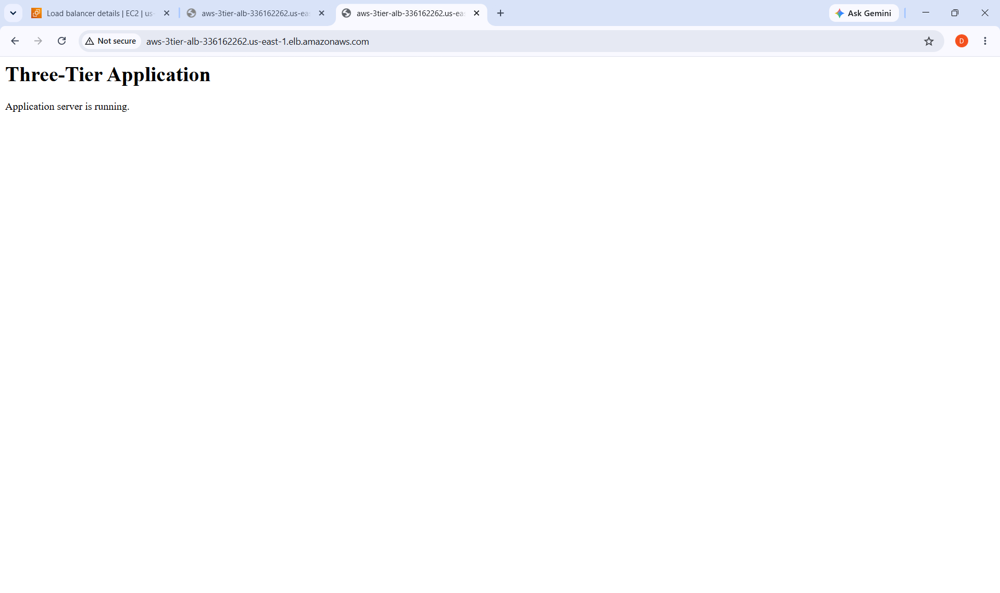
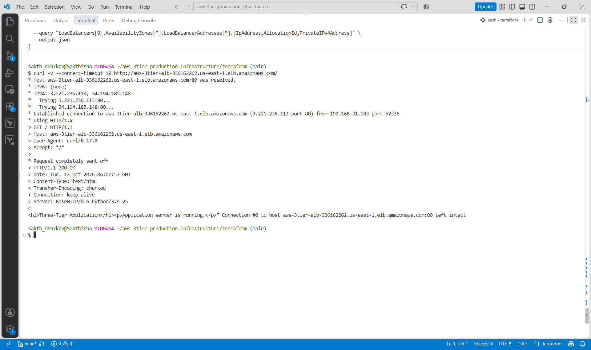
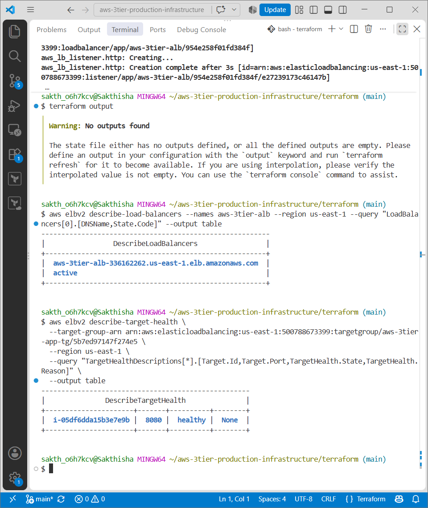

# AWS 3-Tier Production Infrastructure | Terraform

Designed and deployed AWS infrastructure using Terraform, implementing network segmentation, security-group boundaries, private application hosting, and an Application Load Balancer.

**Tech Stack:** AWS · Terraform · VPC · EC2 · Application Load Balancer · IAM · Security Groups · S3 Gateway Endpoint

## Architecture

```text
                         Internet
                            |
                            v
                  Application Load Balancer
                       Public Subnets
                            |
                      HTTP : 80
                            |
                            v
                   Private Application Tier
                     EC2 | Port 8080
                            |
                            v
                    Private Database Tier
                   Subnets & Security Group
```

**AWS Region:** `us-east-1`
**Availability Zones:** `us-east-1a`, `us-east-1b`

## Implementation Highlights

### Networking

* Created a Virtual Private Cloud (VPC) with CIDR `10.0.0.0/16`.
* Designed six subnets across two Availability Zones: two public, two private application, and two private database subnets.
* Configured an Internet Gateway, separate route tables, and subnet associations.
* Implemented an S3 Gateway VPC Endpoint for private connectivity to Amazon S3 without requiring a NAT Gateway for that traffic.

### Security

* Configured separate security groups for the load balancer, application, and database tiers.
* Restricted application traffic to port `8080` from the load balancer security group.
* Restricted database traffic to port `5432` from the application security group.
* Deployed the application EC2 instance in a private subnet without a public IP address.
* Configured an IAM role with AWS Systems Manager permissions for instance management.

### Application Deployment

* Deployed an EC2 application server running a Python HTTP application.
* Configured an Application Load Balancer to receive HTTP traffic on port `80` and forward requests to the application on port `8080`.
* Implemented a `/health` endpoint for application health checks.
* Verified successful HTTP responses and healthy target status.

### Infrastructure as Code

* Provisioned AWS resources using Terraform.
* Organized configurations into separate files for networking, subnets, routing, security groups, and compute resources.
* Used `terraform fmt`, `terraform validate`, and `terraform plan` to format and validate infrastructure changes.

## Verification

The deployed application was verified through:

* Successful HTTP response from the application.
* Successful access through the Application Load Balancer.
* Healthy application target status.
* Terraform configuration validation and plan review.

### Application Screenshots

**Application running in the browser**



**HTTP response verification**



**Load balancer target health**



## Engineering Decisions

* **Application Load Balancer:** Selected for HTTP application traffic routing and health checks.
* **Private application hosting:** Kept the application instance out of direct public internet access.
* **Security-group references:** Used tier-specific rules to restrict traffic between components.
* **S3 Gateway Endpoint:** Enabled private S3 connectivity without adding a NAT Gateway solely for S3 access.

## Project Scope

The database tier includes private subnets and a database security group. A database instance has not been deployed.

## Repository Structure

```text
aws-3tier-production-infrastructure/
├── Architecture/
├── Engineering-Decisions/
├── Infrastructure/
├── screenshots/
└── terraform/
```

## Tools

* **Cloud:** Amazon Web Services (AWS)
* **Infrastructure as Code:** Terraform
* **Compute:** Amazon EC2
* **Networking:** Amazon VPC, subnets, route tables, Internet Gateway
* **Load Balancing:** Application Load Balancer
* **Security:** IAM, security groups, AWS Systems Manager
* **Version Control:** Git and GitHub

---

**Author:** [Sakthisha K.](https://github.com/sakthishak)
**Repository:** [aws-3tier-production-infrastructure](https://github.com/sakthishak/aws-3tier-production-infrastructure)
